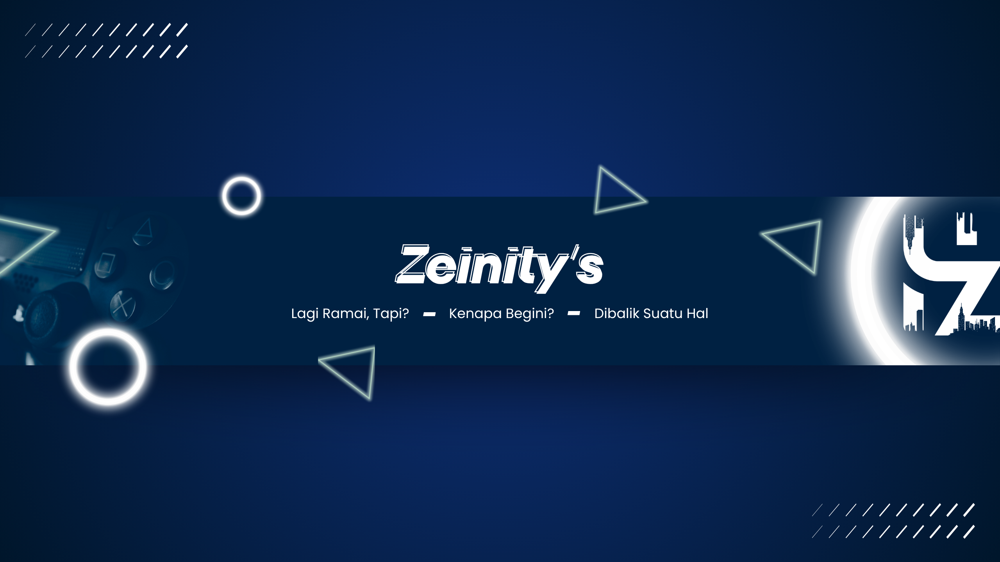

# Zeinity Creator Studio OS (v3.0 — Multi-Format Edition)

<p align="center">
  
</p>

<p align="center">
  
  <br />
  <strong>Pusat Komando Produksi Konten Multi-Format Terverifikasi untuk Kanal @ZeinityShorts</strong>
  <br />
  <em>Shorts (<60s) • Mid-Form (1–3m) • Long-Form (5–8m) • Pipeline-Centric Hub • Dynamic Chapters • AI Voice Cloning TTS Ready</em>
</p>

<p align="center">
  
  
  
  
  
  
</p>

---

## 📌 Ringkasan & Filosofi Multi-Format (v3.0)

**Zeinity Creator Studio OS** adalah sistem operasi produksi konten terpadu yang dirancang khusus untuk memenuhi standar ketat kanal **@ZeinityShorts**. Pada versi **v3.0 (Multi-Format Edition)**, studio ini memperluas kapasitas produksinya dari yang sebelumnya eksklusif video pendek vertikal menjadi sistem multi-format 3 tingkat guna membuka potensi monetisasi penuh pada program kemitraan YouTube (YPP):

| Tingkat Konten (Tier) | Rentang Durasi | Rasio Aspek | Alokasi Kata (WPM 145) | Peran Strategis |
| :--- | :--- | :--- | :--- | :--- |
| **Tier 1: Shorts** | 20 – 60 Detik | 9:16 Vertikal | 50 – 140 Kata | Jangkauan penonton baru & pertumbuhan subscriber |
| **Tier 2: Mid-Form** | 1 – 3 Menit | 9:16 / 16:9 Fleksibel | 150 – 450 Kata | Keseimbangan retensi tinggi & kelayakan iklan |
| **Tier 3: Long-Form** | 5 – 8 Menit | 16:9 Horizontal | 700 – 1.250 Kata | Optimalisasi CPM/RPM tinggi & pendapatan iklan reguler (YPP) |

Sistem ini memastikan setiap video memiliki **akurasi data faktual terverifikasi**, struktur naskah berbobot, kemasan visual bersinergi (*high CTR*), dan alur ekspor suara instan ke notebook AI Voice Cloning (Kaggle).

---

## 🚀 Fitur Unggulan & Arsitektur Terpadu

### 1. Content Pipeline (Pusat Kendali Proyek Terpadu)
* **Segmented Tier Filter Tabs**: Filter cepat satu klik antara `[Semua]`, `[Shorts (<60s)]`, `[Mid-Form (1–3m)]`, dan `[Long-Form (5–8m)]`.
* **Tabel List View Rapi & Bebas Clutter**: Menghilangkan deretan tombol yang berjejal; kini hanya menampilkan tombol utama **"Buka Studio 🎬"**, tombol **"Majukan →"**, dan menu popover tiga titik (`···`).
* **Menu Popover Aksi Sekunder (`···`)**:
  * **Duplikasi Konten (Part 2/3)**: Algoritma penomoran serial otomatis cerdas (`(Part 2)`, `(Part 3)`, dst.) tanpa menimpa data awal.
  * **Salin Narasi Bersih (Kaggle TTS)**: Menyalin teks narasi bersih bebas instruksi B-roll dalam 1-klik, siap tempel ke Kaggle Notebook AI Voice Cloning.
  * **Hapus Konten**: Dengan konfirmasi dialog aman.
* **Kanban Board Interaktif**: Klik langsung pada kartu Kanban membuka Modal Studio Terpadu, dengan isolasi drag-and-drop yang aman.

### 2. Modal Studio Terpadu (Unified Studio Modal — 95vw)
Pusat eksekusi konten layar lebar (`w-[95vw] max-w-7xl h-[90vh]`) yang mengintegrasikan seluruh studio langsung di dalam Pipeline:
* **Header Pintar**: Judul dengan inline validation, status editorial Kanban saat ini, tombol 1-klik *"Majukan Status →"*, indikator total kata dan estimasi durasi waktu bicara, serta proteksi *Rapid-Close* (mencegah data hilang jika modal ditutup mendadak).
* **Tab 1: Naskah Studio**:
  * **Mode 4 Panggung (Shorts)**: Hook (0–3s), Konteks (4–10s), Payoff (11–45s), dan Seamless Loop (46–60s).
  * **Mode Bab Dinamis (Mid & Long-Form)**: Visual Hook, daftar bab fleksibel dengan estimasi timestamp otomatis (misal `⏱️ 01:25`), hitungan kata per bab, tombol geser urutan (↑/↓), tombol hapus, dan outro penutup.
  * **WPM Pacing Meter Dinamis**: Rentang kata otomatis menyesuaikan tier aktif.
  * **Tombol Ekspor Kaggle TTS**: Menyalin teks narasi murni siap olah di Kaggle Notebook.
  * **Riwayat Versi (Snapshot Restore)**: Simpan dan pulihkan revisi naskah kapan saja.
* **Tab 2: Packaging, SEO & Thumbnail Lab**:
  * **Auto YouTube Chapters / Timestamps**: Otomatis dihitung dari kata per bab dan tempo WPM (`00:00 Intro: ...`, `01:25 ...`) dengan proteksi sanitasi baris.
  * **Generator Deskripsi SEO YouTube**: Paragraf pembuka, daftar timestamps, ringkasan pembahasan, tautan rujukan, dan hashtag siap salin.
  * **10 Tag Rekomendasi YouTube**: Kata kunci relevan bebas duplikasi tanda pagar (`#`).
  * **Pinned Comment Engagement Prompt**: Pertanyaan interaktif pemantik diskusi di kolom komentar.
  * **Thumbnail Hook & A/B Concept Lab**: 3 konsep teks gambar yang bersinergi dengan judul, dilengkapi simulator kartu YouTube feed (*Desktop View* vs *Mobile View*) untuk menguji rasio klik (CTR).
* **Tab 3: Metadata & Checklist**:
  * Pilar konten, sub-format dinamis per tier + opsi kustom.
  * **Smart Schedule 1-Klik**: Preset waktu lokal bebas bug timezone (*Shorts: 07:00 WIB* vs *Long-Form: Sabtu 19:00 WIB*).
  * **Checklist Pra-Upload Adaptif**: Poin checklist menyesuaikan secara otomatis mengikuti tier konten.

### 3. Title Validator yang Direlaksasi
* **Aturan Mutlak**: Panjang judul wajib **5–10 kata** (mencegah judul terpotong di antarmuka perangkat mobile YouTube).
* **Aturan Rekomendasi**: Kata tanya (*Apa/Apakah/Kenapa/Bagaimana*) dan tanda tanya (*?*) kini berstatus sebagai **rekomendasi ramah**, tidak lagi memblokir status kelulusan judul.

### 4. CapCut Multi-Format & Chapter Export
* **Ekspor CapCut Draft JSON**: Mendukung resolusi 9:16 (`1080x1920`) dan 16:9 (`1920x1080`), penempatan audio track, serta pembuatan teks subtitle SRT otomatis.
* **Auto-Chapter Marker**: Menyisipkan metadata bab (`script_chapters`) langsung ke dalam timeline CapCut untuk video Mid-Form dan Long-Form.

### 5. Analytics & Learning Lab (Dual-Benchmark)
* **Dual Benchmark Target**: Otomatis mengevaluasi performa video berdasarkan tier (Shorts: Target Retensi >70%, APVD >30s, Swipe Away <30% vs Long-Form: Target Retensi >45%, APVD >180s, CTR >8.0%).
* **11-Format Breakdown**: Analisis komparatif retensi dan rasio performa di seluruh 11 format terverifikasi.
* **CSV Analytics Ingestion**: Impor file ekspor metrik YouTube Studio dengan ekstraksi otomatis durasi ke tier dan rasio klik tayang (CTR).

### 6. Perampingan Navigasi Sidebar (9 Hub Inti)
Menu *Script Studio* dan *Production Studio* telah dilebur ke dalam Modal Terpadu di Pipeline, merampingkan sidebar menjadi 9 hub:
1. `Overview` (Command Center & Daily Focus)
2. `Content Pipeline` (Pusat Kendali Proyek Multi-Format)
3. `Radar Tren` (YouTube Data API v3 & Tech RSS)
4. `Idea Bank` (Triage Ide Mentah, Integrasi Chat Telegram & Skor Kelayakan Konten)
5. `Calendar` (Slot Publikasi Terpisah Shorts 07:00 / Long-Form 19:00 WIB)
6. `Research & Fact Check` (Gemini Grounding & Scraper)
7. `Asset Library` (Manajemen Media & B-Roll)
8. `Analytics & Learning` (Evaluasi Metrik & Benchmark Retensi)
9. `Settings & Integrations Hub` (Supabase Cloud, YouTube API, Telegram Bot Gateway, AI BYOK, RSS Feeds)

### 7. Telegram Bot Ingestion Gateway (Chat-to-Studio Ingestion)
* **Kirim Ide Instan dari HP**: Kirimkan teks ide, tautan berita/changelog, atau screenshot langsung dari Telegram untuk masuk ke **Inbox Ide Mentah**.
* **Manajemen Pengaturan Terpusat di UI**: Tab khusus **Telegram Bot** di Hub Pengaturan untuk memasukkan Bot Token, Owner Chat ID (whitelist pengaman anti-spam), dan pendaftaran Webhook 1-Klik (`setWebhook`).
* **Inspeksi Status Live**: Cek status webhook aktif, jumlah pembaruan tertunda (*pending updates*), dan uji koneksi bot instan (`getMe`).
* **Sinkronisasi Otomatis & Tombol Manual**: Antrean server menyimpan ide masuk dan otomatis mengalirkannya ke browser studio saat Bank Ide dibuka, lengkap dengan tombol *"Sinkronkan Ide Masuk"*.

### 8. macOS Live Diagnostic Terminal Dock (`Ctrl + \``)
* Terminal mengambang bergaya macOS untuk inspeksi kesehatan sistem real-time.
* **Humanized Root-Cause Parser**: Menjelaskan error dalam Bahasa Indonesia (apa yang terjadi, akar masalah, dan solusi konkret).

---

## 🛠️ Tech Stack & Dependensi

* **Frontend Framework**: Next.js 15 (App Router), React 19, TypeScript 5
* **Styling**: Tailwind CSS 3.4, Lucide React Icons
* **Cloud & Basis Data**: Supabase PostgreSQL, Supabase Realtime, Supabase Storage
* **Integrasi AI**: Google Gemini API (dengan Search Grounding), OpenAI, Anthropic, Groq, OpenRouter
* **Pengikis Data**: Cheerio, YouTube Data API v3
* **Penyimpanan Lokal**: Offline-First LocalStorage dengan antrean sinkronisasi mutasi otomatis

---

## 📦 Panduan Instalasi & Menjalankan Proyek

### 1. Klon Repositori
```bash
git clone https://github.com/zenqyverse/zeinity-creator-os-studio.git
cd zeinity-creator-os-studio
```

### 2. Pasang Dependensi
```bash
npm install
```

### 3. Konfigurasi Lingkungan (.env.local)
Salin berkas template lingkungan:
```bash
cp .env.example .env.local
```

Lengkapi kredensial yang dibutuhkan (semua integrasi memiliki fallback offline jika belum diisi):
```env
NEXT_PUBLIC_SITE_URL=http://localhost:3001

# Supabase Personal Cloud (Opsional)
NEXT_PUBLIC_SUPABASE_URL=https://your-project.supabase.co
NEXT_PUBLIC_SUPABASE_ANON_KEY=your-anon-key-here

# YouTube Data API v3 (Opsional)
YOUTUBE_API_KEY=

# AI Provider BYOK (Opsional)
GEMINI_API_KEY=

# Telegram Bot Ingest (Opsional)
TELEGRAM_BOT_TOKEN=
TELEGRAM_OWNER_CHAT_ID=

# Universal Ingest Secret
ZEINITY_INGEST_SECRET=super-secret-token
```

### 4. Migrasi Basis Data Supabase (Opsional)
Jika menghubungkan ke Supabase, jalankan berkas migrasi SQL secara berurutan di Supabase SQL Editor:
1. `supabase/migrations/001_initial_schema.sql` — Skema fondasi tabel studio, pipeline, ide, dan analitik.
2. `supabase/migrations/002_multi_format_expansion.sql` — Ekspansi multi-tier (`content_tier`), `thumbnail_ctr`, relaksasi format constraint, dan 11 format terverifikasi.

### 5. Jalankan Server Pengembangan
```bash
npm run dev
```
Buka peramban di [http://localhost:3001](http://localhost:3001).

---

## 🧪 Pengujian & Verifikasi (Automated Test Suites)

Proyek dilengkapi dengan test suite mandiri untuk memastikan integritas logika bisnis multi-format:

```bash
# Menjalankan suite pengujian komprehensif Fase 5 (8 modul uji)
npm test

# Menjalankan seluruh rangkaian tes integrasi (Fase 3, 4, dan 5)
npm run test:all

# Pemeriksaan ketat tipe TypeScript (Zero Errors)
npx tsc --noEmit

# Validasi build produksi Next.js 15
npm run build
```

---

## ⌨️ Pintasan Keyboard (Global Shortcuts)

| Pintasan | Lingkup | Fungsi |
| :--- | :--- | :--- |
| `/` | Global | Buka Pencarian Global (Global Search Modal) |
| `Ctrl + S` / `Cmd + S` | Global / Studio | Simpan Instan Draft / Kirim Formulir Aktif |
| `Ctrl + 1` | Studio Modal | Pindah ke Tab 1 (Naskah Studio) |
| `Ctrl + 2` | Studio Modal | Pindah ke Tab 2 (Packaging, SEO & Thumbnail) |
| `Ctrl + 3` | Studio Modal | Pindah ke Tab 3 (Metadata & Checklist) |
| `Ctrl + \`` | Global | Buka / Tutup macOS Live Diagnostic Terminal |
| `Esc` | Global / Modal | Tutup Modal Studio, Drawer, atau Pencarian Aktif |

---

## 📄 Lisensi & Hak Cipta

Dikelola dan dikembangkan secara eksklusif untuk **Zeinity Studio** (@ZeinityShorts).  
Hak cipta dilindungi undang-undang &copy; 2026.