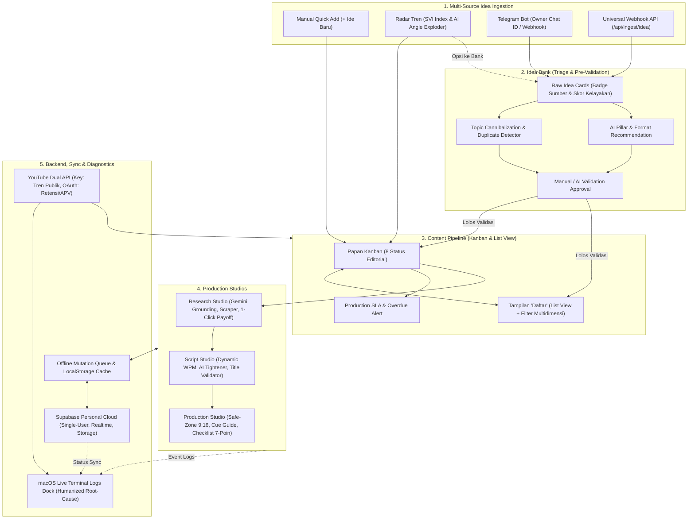

# Zeinity Creator Studio OS — Master Blueprint v2 (Spesifikasi Final)

Dokumen ini merangkum seluruh konsensus arsitektural, rancangan UX, alur data, integrasi eksternal, dan matriks fitur pendukung yang disepakati melalui wawancara terarah (`/grill-me` Sesi 1 & Sesi 2).

---

## 1. Diagram Alur Sistem Terintegrasi (End-to-End Architecture)

---

## 2. Konsensus Arsitektur & Spesifikasi Lengkap

### A. Alur Validasi Ide & Ingestion Gateway
1. **Pemisahan Jalur Input:**
   - **Jalur Langsung (Kreator Aktif):** Input manual di tab Content Pipeline atau promosi tren dari Radar Tren langsung berstatus `Ide` di Content Pipeline.
   - **Jalur Eksternal (Mentah):** Ide dari Telegram Bot atau Webhook API wajib masuk ke **Idea Bank** terlebih dahulu sebagai **Ide Mentah**.
2. **Kurasi di Idea Bank (Idea Triage):**
   - Kartu ide mentah dilengkapi: **Badge Sumber** (`[Telegram]`, `[Webhook]`, `[Manual]`), **Skor Kelayakan Shorts (0–100)**, **Peringatan Duplikasi Topik**, dan **Rekomendasi AI 5 Pilar & 4 Format**.
   - Aksi 1-klik: **Loloskan ke Pipeline** (menjadi kartu konten aktif di Pipeline), **Simpan di Backlog**, atau **Hapus**.
   - Mendukung **Batch Action** untuk mengurasi beberapa ide sekaligus.
3. **Telegram Bot Specification:**
   - Terproteksi berdasarkan **Owner Chat ID** (hanya pemilik channel yang diterima).
   - Mendukung chat natural (teks langsung jadi ide mentah), pesan gambar/screenshot berketerangan, serta slash commands:
     - `/idea [topik/tautan]`: mencatat ide secara eksplisit.
     - `/status`: ringkasan status produksi terkini.
     - `/ping`: cek kesehatan koneksi bot ke studio.
   - Diproses melalui endpoint webhook Next.js: `/api/telegram/webhook`.
4. **Email Ingestion:** Ditangguhkan sementara sesuai instruksi (ide email dikelola oleh agen eksternal Gemini Spark).

---

### B. Backend Cloud, Auth & Resiliensi Offline
1. **Model Cloud:** **Single User Personal Cloud** via Supabase. Satu akun channel owner dengan sinkronisasi otomatis antar perangkat (desktop/laptop/tablet/ponsel).
2. **Migrasi Data:** Dialog 1-klik migrasi data dari `LocalStorage` ke Supabase saat login pertama kali.
3. **Sinkronisasi:** **Supabase Realtime** (`postgres_changes`) untuk update langsung tanpa refresh halaman.
4. **Resiliensi Jaringan:** **Offline Mutation Queue**. Saat internet terputus, mutasi diantrekan secara lokal dan otomatis disinkronkan saat koneksi online kembali.
5. **Media Storage:** Supabase Storage Bucket (`zeinity-media`) untuk menyimpan tangkapan layar, frame thumbnail, dan B-roll dengan URL CDN publik.

---

### C. Integrasi YouTube & Channel Analytics
1. **Dual Integration Model:**
   - **YouTube Data API v3 Key:** Untuk penarikan tren publik dan pencarian video topik serupa.
   - **Google Cloud OAuth 2.0:** Untuk sinkronisasi metrik analitik channel pribadi (Views, Retensi, Shown in Feed, Stayed-to-Watch %, APV).
2. **Auto-Link & Benchmark Evaluation:**
   - Video yang sudah publish di YouTube otomatis dicocokkan dengan kartu konten di Pipeline.
   - Metrik langsung dievaluasi terhadap standar baku Zeinity: **Target APV 90%–110%** dan **Viewed vs Swiped Away >= 70%**.
3. **Smart Experiment Engine:** Menganalisis korelasi performa masa lalu (gaya hook & format dengan APV tertinggi) untuk merekomendasikan formula taktis pada video berikutnya.

---

### D. AI Autonomous Research Agent & Fact-Checking
1. **Dual-Engine Search:** **Gemini Google Search Grounding** untuk pencarian web komprehensif + **Direct URL Scraper** untuk mengekstrak isi changelog/dokumentasi resmi.
2. **Verifikasi Sumber:**
   - Ekstraksi kutipan bukti verbatim dan tautan resmi ke kartu riset.
   - Klasifikasi status objektif: `Terverifikasi`, `Perlu Konfirmasi`, `Kedaluwarsa`, serta penanda `Rumor` atau `Klaim Promosi`.
   - **Quick URL Preview & Metadata Scraper:** Menarik judul, tanggal, dan nama platform saat URL ditempel.
   - **Stale Fact Warning:** Peringatan otomatis untuk rilis yang berusia > 6 bulan.
3. **Draf Naskah 4-Fase Mandiri:**
   - Menghasilkan naskah (Hook, Context, Payoff, Ending) yang patuh batas durasi format (Flash News, Quick Breakdown, Tip, Myth Buster).
   - **1-Click Push to Script Payoff:** Tombol cepat menyisipkan fakta/angka bukti ke naskah.
   - **Seamless Loop Generator:** Menyusun ending (detik 46–60) yang menyambung mulus kembali ke detik 0.
   - **3 Opsi Judul Baku:** Judul kalimat tanya (Apa/Kenapa/Bagaimana, 5–10 kata) yang lolos Title Validator.

---

### E. Script Studio & Stabilitas Kalkulator
1. **Kalibrasi Validator Dinamis per Format:**
   - **Flash News (20–30s):** Ambang aman 50–75 kata.
   - **Quick Breakdown (30–45s):** Ambang aman 75–110 kata.
   - **Myth Buster (30–45s):** Ambang aman 75–110 kata.
   - **Actionable Tip (45–60s):** Ambang aman 110–140 kata.
   - Mencegah naskah Flash News ditandai "terlalu pendek" secara keliru.
2. **AI Script Tightener & Word Trimmer:** Tombol 1-klik untuk merapikan dan memangkas kata-kata boros pada naskah yang overbudget tanpa mengubah makna teknis.
3. **Voiceover & Teleprompter:** Diabaikan/out-of-scope karena voiceover diproduksi secara terpisah menggunakan AI Voice Cloning di Kaggle.

---

### F. Production Studio & Safe-Zone (9:16)
1. **Visual Simulator 9:16:** Area aman atas 15%, tengah 60%, bawah 25% (simulasi overlay YouTube Shorts).
2. **Text Overlay Tester:** Pengatur cepat warna teks (Kuning Zeinity / Sian / Putih) dengan simulasi drop-shadow kontras.
3. **Timing Presets:** Tombol 1-klik membagi shot mengikuti segmen baku (0–3s, 4–10s, 11–45s, 46–60s).
4. **Production Sheet & Editing Cue Guide:** Dokumen ringkasan 1-klik (tabel pemetaan shot, teks layar, B-roll, checklist) siap salin/ekspor Markdown untuk panduan di CapCut/Premiere.
5. **7-Point Checklist:** Checklist (B-roll, Audio, Musik, Kontras, Caption, Review Akhir) yang otomatis memperbarui status kesiapan visual.

---

### G. macOS Live Terminal Logs & Diagnostic Dock
1. **Desain UI/UX:**
   - Floating collapsible dock di sudut bawah layar (shortcut `Ctrl+\`` atau tombol status di header).
   - Tampilan jendela macOS dengan 3 tombol traffic-light (merah: tutup, kuning: minimize, hijau: maximize), dark glassmorphism, dan font monospace.
2. **Humanized Root-Cause Diagnosis (Bahasa Manusiawi):**
   - Setiap error disajikan dalam 3 poin konkret:
     - **Apa yang terjadi:** Penjelasan ringkas dan mudah dipahami.
     - **Akar masalah sebenarnya:** Analisis teknis mendalam (kegagalan jaringan, batasan kuota, CORS, format tidak valid).
     - **Langkah solusi langsung:** Tindakan nyata 1-2-3 yang bisa diambil kreator.
3. **Filter & Fitur Kontrol:**
   - Filter tab kategori: `[Semua]`, `[Supabase]`, `[AI Agent]`, `[YouTube API]`, `[Radar Ingestion]`, `[Validator]`.
   - Tombol **1-Click Diagnostics Self-Test** (ping kesehatan Supabase, AI API, YouTube API, Storage).
   - Tombol **Salin Log** dan **Ekspor Berkas Diagnosa (.log)**.

---

### H. UI/UX, QoL & Antarmuka Global
1. **Standar Form:** **Center Modal Popup Klasik** dengan latar belakang gelap dan blur di seluruh aplikasi.
2. **Pipeline View:** Mendukung **Kanban Board** DAN **Tampilan 'Daftar' (List View)** dengan filter multidimensi (5 Pilar, 4 Format, Visual Readiness, Status).
3. **Fitur QoL:**
   - **Jadwal Pintar 1-Klik:** Preset cepat tanggal publikasi berikutnya (Senin/Kamis/Minggu 07:00 WIB).
   - **Quick Duplicate Card:** Duplikasi kartu untuk konten berseri / Part 2.
   - **Undo Toast Recovery:** Tombol batalkan penghapusan atau pemindahan kartu.
   - **Global Keyboard Shortcuts:** `Ctrl+K` (Search), `Ctrl+\`` (Terminal), `Ctrl+S` (Save), `Esc` (Close Modal).
   - **Visual Milestone Celebration:** Efek glow halus saat naskah 100% valid atau checklist selesai.
4. **Command Center (Overview):** Widget **Daily Action Focus ("Tugas Kritis Hari Ini")** yang langsung menampilkan prioritas mendesak saat membuka aplikasi.

---

## 3. Rencana Eksekusi Bertahap (Implementation Roadmap)

| Tahap | Fokus Pekerjaan | Modul / Berkas Terkait |
|---|---|---|
| **Fase 1** | **Fondasi Stabilitas, Terminal & Validator** - Kalibrasi ambang batas kata dinamis per format - macOS Live Terminal Logs & Diagnostic Dock - Humanized Root-Cause Parser engine - Offline Mutation Queue & LocalStorage failover | `lib/validator.ts` `components/MacTerminalDock.tsx` `lib/diagnostic-service.ts` `lib/storage.ts` |
| **Fase 2** | **Arsitektur UX, QoL & Pipeline Views** - Tampilan "Daftar" (List View) di Pipeline - Topic Cannibalization & Overdue Alert - Center Modal Popup standar & QoL presets (Jadwal 1-klik, Duplicate, Undo) - Widget Daily Action Focus di Overview | `components/modules/PipelineModule.tsx` `components/modules/OverviewModule.tsx` `components/forms/StudioForms.tsx` `components/ToastContainer.tsx` |
| **Fase 3** | **Idea Triage & Telegram Ingestion Gateway** - Redesain Idea Bank dengan Triage Gate (Badge, Skor Shorts, Batch Actions) - Webhook API `/api/telegram/webhook` (Owner Chat ID, `/idea`, `/status`, `/ping`) - Universal Webhook `/api/ingest/idea` - AI Auto-Recommendation (Pilar & Format) | `components/modules/IdeaBankModule.tsx` `app/api/telegram/webhook/route.ts` `app/api/ingest/idea/route.ts` `lib/ai-service.ts` |
| **Fase 4** | **AI Autonomous Research & Script Tightener** - Gemini Grounding + Direct URL Scraper changelog - Ekstraksi kutipan bukti & Stale Fact warning - Seamless Loop & 3 Judul Tanya Generator - AI Script Tightener & Word Trimmer di Script Studio | `app/api/ai/generate/route.ts` `components/modules/ResearchModule.tsx` `components/modules/ScriptStudioModule.tsx` |
| **Fase 5** | **Cloud Backend & YouTube Dual Integration** - Supabase Single-User Personal Cloud sync & storage - YouTube API Key (live trends) + Google OAuth (retensi/APV) - Auto-Link konten terbit & evaluasi benchmark - Smart Experiment Engine di Analytics Module | `lib/supabase.ts` `app/api/trends/youtube/route.ts` `components/modules/AnalyticsModule.tsx` `components/modules/AiSettingsModule.tsx` |
