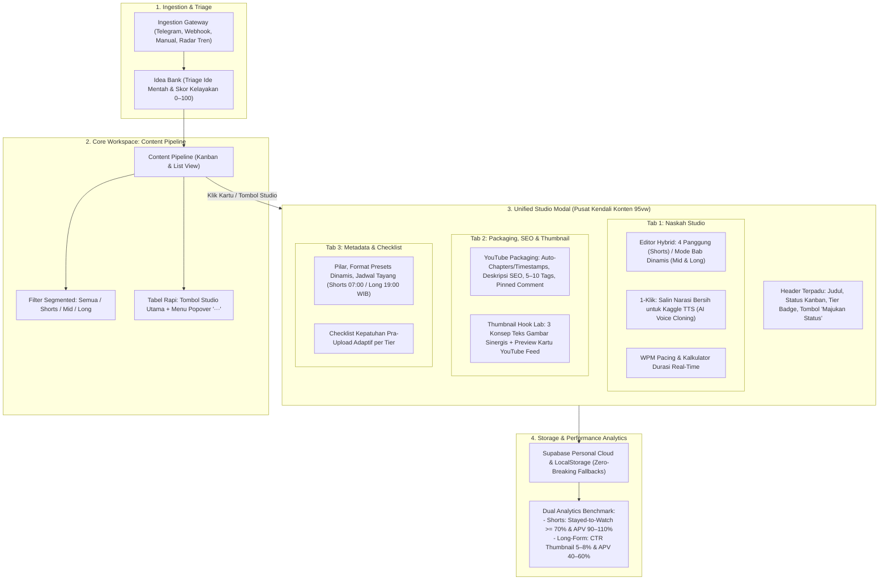

# Zeinity Creator Studio OS — Master Blueprint v3: Multi-Format Expansion & Unified Architecture

Dokumen Master Blueprint ini merangkum seluruh konsensus arsitektur baru hasil wawancara terarah (`/grill-me` Sesi 1 & 2). Blueprint ini memperluas kapasitas Zeinity dari yang sebelumnya eksklusif **YouTube Shorts (<60 detik)** menjadi ekosistem multi-format terpadu: **Shorts (<60 detik)**, **Mid-Form (1–3 menit)**, dan **Long-Form (5–8 menit)**, sekaligus merevolusi alur kerja UX dengan memusatkan seluruh studio ke dalam **Modal Studio Terpadu (Unified Content Hub)** langsung di dalam Content Pipeline.

---

## 1. Diagram Alur Sistem Terintegrasi (End-to-End Pipeline-Centric Architecture)



---

## 2. Matriks 3 Format Konten (Content Tiers)

| Atribut / Dimensi | Tier 1: Shorts (Short-Form) | Tier 2: Mid-Form | Tier 3: Long-Form |
|---|---|---|---|
| **Rentang Durasi** | **20 – 60 Detik** | **1 – 3 Menit (60 – 180 Detik)** | **5 – 8 Menit (300 – 480 Detik)** |
| **Rasio Aspek** | **9:16 Vertikal** | **Fleksibel (9:16 Extended Shorts / 16:9 Mid-form)** | **16:9 Horizontal Mutlak** |
| **Tujuan Monetisasi** | Jangkauan penonton baru & pertumbuhan subscriber | Keseimbangan retensi tinggi & monetisasi iklan reguler | CPM/RPM optimal & pendapatan iklan jangka panjang (YPP) |
| **Ambang Batas Kata** | **50 – 140 Kata** (130–160 WPM) | **150 – 450 Kata** (130–160 WPM) | **700 – 1.250 Kata** (130–160 WPM) |
| **Struktur Naskah** | **4 Panggung Baku:**<br>1. Hook (0–3s)<br>2. Context (4–10s)<br>3. Payoff (11–45s)<br>4. Seamless Loop (46–60s) | **Mode Bab Adaptif (2–4 Bab):**<br>- Hook / Premis Utama<br>- Bab 1: Konteks & Masalah<br>- Bab 2: Solusi & Bukti Riil<br>- Outro / Smart CTA | **Mode Bab Dinamis (4–7 Bab):**<br>- Visual Hook (0–15s)<br>- Executive Intro (15–45s)<br>- Bab 1..N: Analisis Mendalam<br>- Climax / Ringkasan Inti<br>- Outro & Rekomendasi Video |
| **Preset Sub-Format** | Flash News, Quick Breakdown, Myth Buster, Actionable Tip, Kustom | Deep Explainer, Mini Tutorial, Case Breakdown, Kustom | Video Essay, Masterclass, Case Investigation, Ecosystem Review, Kustom |
| **Integrasi Audio** | AI Voice Cloning (Kaggle) | AI Voice Cloning (Kaggle) | AI Voice Cloning (Kaggle) |

---

## 3. Revolusi UX: Modal Studio Terpadu di Content Pipeline

### A. Perampingan Navigasi Sidebar (`Sidebar.tsx`)
Menu yang sebelumnya 11 item dipadatkan menjadi **9 Hub Utama**. Menu `Script Studio` dan `Production Studio` **dihapus dari sidebar** dan dipusatkan ke dalam Pipeline:
1. Overview
2. **Content Pipeline (Pusat Kendali Kerja Konten)**
3. Radar Tren
4. Idea Bank
5. Calendar
6. Research & Fact Check
7. Asset Library
8. Analytics & Learning
9. AI Settings (BYOK)

### B. Perapian Antarmuka Pipeline (`PipelineModule.tsx`)
1. **List View:**
   * Menghilangkan deretan 5 tombol yang berjejal.
   * Hanya menampilkan 1 tombol utama: **"Buka Studio 🎬"** dan tombol **"Majukan →"**.
   * Aksi sekunder (Duplikasi, Hapus, Salin Teks) dimasukkan ke dalam **Menu Popover Tiga Titik (`···`)**.
2. **Kanban View:**
   * Mengklik kartu kanban langsung membuka **Modal Studio Terpadu**.
   * Footer kartu dilengkapi tombol cepat `"Maju →"`.
3. **Filter Segmented Tier:**
   * Filter cepat: `[Semua]`, `[Shorts <60s]`, `[Mid-Form 1–3m]`, `[Long-Form 5–8m]`.

### C. Anatomi Modal Studio Terpadu (`UnifiedStudioModal.tsx`)
Modal berukuran **95vw (Max 7XL) h-[90vh]** dengan backdrop gelap blur, scroll independen, dan shortcut tab (`Ctrl+1`, `Ctrl+2`, `Ctrl+3`):
* **Header Bar:**
  * Judul konten (dapat diedit in-place).
  * Badge Tier (`Shorts 9:16`, `Mid-Form`, `Long-Form 16:9`).
  * Status editorial saat ini + Tombol 1-klik *"Majukan Status"*.
  * Indikator total kata dan estimasi durasi waktu bicara.
* **Tab 1: Naskah Studio:**
  * Shorts: 4 kolom panggung klasik.
  * Mid/Long: Mode Bab Dinamis (+ Tambah Bab, Hapus Bab, Reorder).
  * WPM Meter dinamis.
  * **Fitur Utama: Tombol 1-Klik "Salin Narasi Bersih untuk Kaggle TTS"** (otomatis membersihkan penanda B-roll dan tanda kurung, menghasilkan teks murni siap tempel ke notebook Kaggle).
* **Tab 2: Packaging, SEO & Thumbnail (Pengganti SafeZone Canvas):**
  * **YouTube Packaging & SEO Generator:**
    * Otomatis menghitung dan membuat **Video Chapters / Timestamps** (`00:00 Intro`, `01:25 ...`) berdasarkan kata per bab dan WPM.
    * Generator draf deskripsi ramah SEO YouTube (paragraf pembuka, ringkasan, rujukan).
    * Rekomendasi 5–10 Tag kata kunci.
    * Pinned Comment Engagement Prompt (pertanyaan interaktif pemantik diskusi).
  * **Thumbnail Hook & A/B Concept Lab:**
    * 3 Variasi ide teks visual thumbnail (yang bersinergi dengan judul, bukan sekadar mengulang kata judul).
    * Mockup Preview Kartu YouTube Feed (Desktop & Mobile) untuk menguji keterbacaan CTR.
* **Tab 3: Metadata & Checklist:**
  * Pengaturan Pilar, Sub-format dinamis, Sumber riset, dan Catatan.
  * **Jadwal Pintar 1-Klik:** Slot Shorts (Sen/Kam/Min 07:00 WIB) & Slot Long-form (Sabtu 19:00 WIB).
  * **Checklist Pra-Upload Adaptif:** Otomatis menyesuaikan poin checklist berdasarkan tier yang aktif.

---

## 4. Pembersihan Kode Usang & Deprecations

* **Hapus Permanen:**
  * `components/SafeZoneCanvas.tsx` (dihapus karena tidak relevan dengan niche literasi digital Zeinity dan telah digantikan oleh YouTube Packaging & Thumbnail Lab yang jauh lebih bernilai tinggi).
  * `components/TeleprompterModal.tsx` (dihapus karena kreator menggunakan AI Voice Cloning di Kaggle Notebook).
  * `components/modules/ProductionStudioModule.tsx` (direfaktor dan diserap ke dalam `UnifiedStudioModal.tsx`).

---

## 5. Skema Data & Validasi

### A. Tipe Data TypeScript (`lib/types.ts`)
```typescript
export type ContentTier = 'short' | 'mid' | 'long';
export type AspectRatio = '9:16' | '16:9';

export interface ScriptChapter {
  id: string;
  chapter_number: number;
  title: string;
  timestamp_estimate?: string; // e.g. "01:30"
  content: string;
  word_count: number;
}

export interface ContentItem {
  id: string;
  type: 'content' | 'idea';
  title: string;
  pillar: Pillar;
  format: VideoFormat;
  content_tier?: ContentTier;      // Default: 'short'
  aspect_ratio?: AspectRatio;      // Default: '9:16'
  status: EditorialStatus;
  priority: Priority;
  visual_readiness: VisualReadiness;
  // Shorts Fields
  hook?: string;
  script_hook?: string;
  script_context?: string;
  script_payoff?: string;
  script_ending?: string;
  // Mid/Long-Form Chapters
  script_chapters?: ScriptChapter[];
  // Packaging & SEO
  seo_description?: string;
  seo_tags?: string[];
  pinned_comment_prompt?: string;
  thumbnail_hooks?: string[];
  // Metrics & Schedule
  word_count?: number;
  duration_estimate?: number;
  target_wpm?: number;
  publish_date?: string;
  production_due?: string;
  source_url?: string;
  source?: 'telegram' | 'webhook' | 'manual' | 'radar';
  viability_score?: number;
  created_at: string;
  updated_at: string;
}
```

### B. Relaksasi Validator Judul (`lib/validator.ts`)
* **Aturan Mutlak:** Panjang judul wajib **5–10 kata** (mencegah judul terpotong di layar ponsel).
* **Aturan Rekomendasi:** Kata tanya `Apa/Kenapa/Bagaimana` dan tanda tanya `?` diubah menjadi **saran/tip**, tidak lagi memblokir status kelulusan validasi (`isValid = true`).
